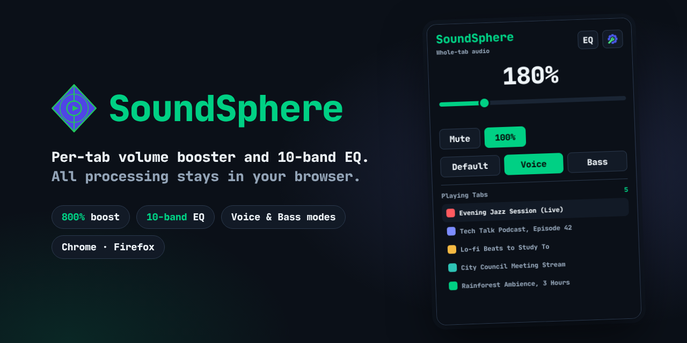
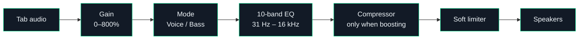

<p align="center">
  
</p>

<p align="center">
  <a href="https://chromewebstore.google.com/detail/soundsphere/bmdclfobmjbikodcmbdhmfoadboimaln"></a>
  &nbsp;
  <a href="https://addons.mozilla.org/en-US/firefox/addon/soundsphere/"></a>
</p>

<p align="center">
  <a href="https://chromewebstore.google.com/detail/soundsphere/bmdclfobmjbikodcmbdhmfoadboimaln"></a>
  <a href="https://addons.mozilla.org/en-US/firefox/addon/soundsphere/"></a>
  <a href="https://github.com/ripDZL/SoundSphere/actions/workflows/build.yml"></a>
  <a href="LICENSE"></a>
</p>

<p align="center">
  <b>Boost quiet tabs up to 800%, shape the sound with a 10-band EQ, and keep every playing tab in view.</b><br>
  No accounts, no tracking, no servers. All audio processing stays in your browser.
</p>

<p align="center">
  <a href="#highlights">Highlights</a> ·
  <a href="#quick-start">Quick start</a> ·
  <a href="#browser-support">Browser support</a> ·
  <a href="#how-it-works">How it works</a> ·
  <a href="#privacy--permissions">Privacy</a> ·
  <a href="#faq">FAQ</a> ·
  <a href="#development">Development</a>
</p>

---

## Highlights

<table>
  <tr>
    <td width="33%" valign="top">
      <h3>Up to 800% boost</h3>
      Per-tab volume from 0% to 800%. A compressor and soft limiter keep heavy boosts from clipping harshly.
    </td>
    <td width="33%" valign="top">
      <h3>10-band equalizer</h3>
      31 Hz to 16 kHz with 12 presets (Rock, Jazz, Vocal, Bass Boost, V-Shape and more) plus your own custom curve.
    </td>
    <td width="33%" valign="top">
      <h3>Voice &amp; Bass modes</h3>
      One-click modes for clearer dialogue in videos and podcasts, or more low end for music and games.
    </td>
  </tr>
  <tr>
    <td width="33%" valign="top">
      <h3>Transparent at 100%</h3>
      With a flat EQ and Default mode, audio passes through unchanged. Only peaks near full scale reach the limiter.
    </td>
    <td width="33%" valign="top">
      <h3>Every playing tab</h3>
      See which tabs are making sound, jump to one in a click, and show a count on the toolbar badge.
    </td>
    <td width="33%" valign="top">
      <h3>Light and private</h3>
      No page audio is touched until you use the popup, the engine shuts down when idle, and nothing ever leaves your device.
    </td>
  </tr>
</table>

<p align="center">
  
  &nbsp;&nbsp;&nbsp;
  
</p>

## Quick start

1. Install SoundSphere for [Chrome](https://chromewebstore.google.com/detail/soundsphere/bmdclfobmjbikodcmbdhmfoadboimaln) or [Firefox](https://addons.mozilla.org/en-US/firefox/addon/soundsphere/) and pin it to the toolbar.
2. Go to a tab that is playing audio and click the SoundSphere icon.
3. Drag the slider, pick **Voice** or **Bass**, or open **EQ** to choose a preset. Changes apply instantly to that tab only.

Opening the popup by itself never changes a tab's audio. Settings such as the toolbar badge, remembered volume and 800% overdrive are under the gear icon.

## Browser support

| | Chrome | Firefox |
|---|---|---|
| Minimum version | 116 | 140 (desktop), 142 (Android) |
| Boost, EQ and modes | Any site that plays audio | Standard HTML5 players such as YouTube, Bandcamp and SoundCloud |
| Protected (DRM) audio, e.g. Spotify Web | Full support | Volume 0–100% and mute ¹ |
| Website access required | None | All sites |

¹ Firefox does not allow extensions to process DRM-protected audio. On those sites SoundSphere greys out boost, EQ and modes and explains why in the popup.

## How it works

Every tab gets its own Web Audio processing chain:



**Chrome** captures the tab's audio with the `tabCapture` API and runs the chain in a hidden offscreen document. Clicking the toolbar icon grants access to that one tab (`activeTab`), so the Chrome version needs no website permissions and runs no scripts in web pages. The offscreen document closes on its own once no tab is being processed.

**Firefox** has no tab capture for extensions, so SoundSphere routes the page's own `<audio>` and `<video>` elements through the chain. It only reroutes audio that Web Audio can actually read, so it never silences playback. When a site streams media from another domain without CORS headers (Bandcamp, for example), SoundSphere adds a CORS header to media in that tab only and reloads the track once. The rule is removed when the tab closes.

## Privacy & permissions

SoundSphere collects no data. There are no analytics, no telemetry, no ads and no remote code, and the extension has no servers: nothing is ever sent anywhere. Audio is processed in real time on your device and is never recorded or saved. Settings stay in your browser's extension storage. Read the full [privacy policy](privacy.html).

| Permission | Browser | Why it's needed |
|---|---|---|
| `activeTab` | Both | Work with the tab where you opened the popup |
| `tabs` | Both | List tabs that are playing audio and switch to them |
| `storage` | Both | Save your settings |
| `tabCapture`, `offscreen` | Chrome | Capture and process the tab's audio locally |
| Access to all websites | Firefox | Adjust the page's audio and video players |
| `declarativeNetRequestWithHostAccess` | Firefox | Add a CORS header to media in a boosted tab so cross-domain audio can be processed |

## FAQ

<details>
<summary><b>Why are EQ, Voice and Bass greyed out on Spotify in Firefox?</b></summary>
<br>
Spotify Web plays DRM-protected audio, and Firefox does not let any extension process it. SoundSphere can still change the volume from 0% to 100% and mute it. In Chrome, Spotify works with every feature because SoundSphere processes the finished tab audio.
</details>

<details>
<summary><b>Why does a Bandcamp track restart for a moment when I boost it in Firefox?</b></summary>
<br>
Bandcamp serves audio from another domain without the CORS headers Web Audio needs. The first time you boost, SoundSphere reloads the track with CORS allowed for that tab, keeping your position. After that, boost and EQ apply normally.
</details>

<details>
<summary><b>Chrome says "Click the SoundSphere icon while on this tab to control it." Why?</b></summary>
<br>
The Chrome version only gets access to a tab when you click its icon on that tab. That's what lets it work without asking for access to your data on websites. If you picked a tab from the playing-tabs list, switch to it and click the icon there.
</details>

<details>
<summary><b>Firefox says "Click the page once to enable boost and EQ."</b></summary>
<br>
Firefox doesn't start audio processing on a page until you have interacted with it. This happens when a video started playing by itself. Click anywhere on the page once and the boost applies.
</details>

<details>
<summary><b>Does SoundSphere change my system volume?</b></summary>
<br>
No. It only changes the audio of the tab you adjust. Other tabs and other apps are not affected.
</details>

<details>
<summary><b>Is 800% safe?</b></summary>
<br>
High boost levels can distort audio and may damage hearing or speakers. Start low, especially with headphones. Levels above 600% are an optional overdrive that you can turn off in Settings.
</details>

## What's new in 1.3.1

<details>
<summary>Release notes</summary>
<br>

- **Chrome:** no website access needed anymore; SoundSphere works through tab capture alone.
- **Chrome:** fixed audio that could double up when moving the slider quickly, and the audio engine now shuts down when nothing is boosted.
- **Firefox:** boost and EQ now work on Bandcamp, SoundCloud and other sites that stream audio from another domain.
- **Firefox:** Spotify volume and mute now work; unavailable controls are greyed out with an explanation.
- 100% with a flat EQ now passes audio through unchanged.
- Opening the popup no longer changes a tab's audio on its own.
- Remembered tab volumes no longer carry over to unrelated tabs after a browser restart.
- Better screen reader and keyboard support.
</details>

---

## Development

```
SoundSphere-1.3/          Extension source, shared by both browsers
  manifest.json           Chrome manifest (MV3)
  manifest.firefox.json   Firefox manifest (MV3), packaged as manifest.json
tests/1.3/                Regression harness (Node.js, no dependencies)
tools/package-1.3.sh      Builds the store packages
tools/render-readme-assets.js   Regenerates the README images from the real popup
beta/                     Latest CI build (.zip for Chrome, .xpi for Firefox)
store-assets/             Banner, screenshots and store icons (not packaged)
Docs/                     Architecture, decisions and store submission notes
```

**Requirements:** Node.js 18+, Python 3 and `zip`. Playwright is only needed to regenerate the README images.

```bash
# Run the regression harness
node tests/1.3/test.js

# Build SoundSphere-<version>-chrome.zip and SoundSphere-<version>-firefox.xpi
bash tools/package-1.3.sh dist
```

**Load an unpacked build**

- **Chrome:** open `chrome://extensions`, enable Developer mode, choose **Load unpacked** and select `SoundSphere-1.3/`.
- **Firefox:** open `about:debugging#/runtime/this-firefox`, choose **Load Temporary Add-on** and select the `.xpi` from `beta/` or `dist/`.

Every push to `main` runs the tests and publishes fresh packages to `beta/`.

## Support

Found a bug or have an idea? [Open an issue](https://github.com/ripDZL/SoundSphere/issues) and include your browser and version, the site, and what you expected to happen.

## License

Released under the [MIT License](LICENSE). The bundled JetBrains Mono font is licensed under the SIL Open Font License 1.1 (`SoundSphere-1.3/fonts/OFL.txt`).
