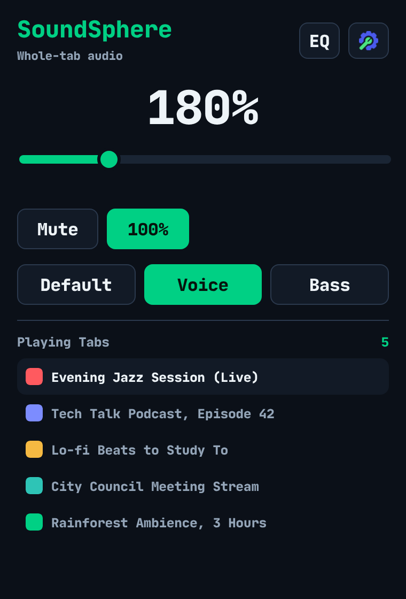
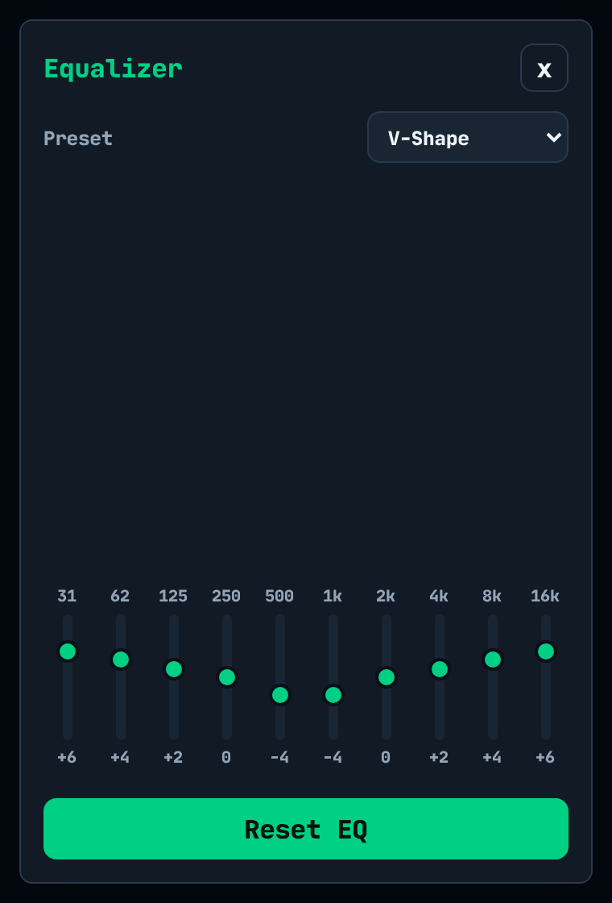

<p align="center">
  
</p>

<h1 align="center">SoundSphere</h1>

<p align="center">
  Per-tab volume booster and 10-band equalizer for Chrome and Firefox.<br>
  Boost quiet tabs up to 800%, shape the sound, and keep every playing tab in view. All processing stays in your browser.
</p>

<p align="center">
  <a href="https://chromewebstore.google.com/detail/soundsphere/bmdclfobmjbikodcmbdhmfoadboimaln"></a>
  <a href="https://addons.mozilla.org/en-US/firefox/addon/soundsphere/"></a>
  <a href="https://github.com/ripDZL/SoundSphere/actions/workflows/build.yml"></a>
  <a href="LICENSE"></a>
</p>

<p align="center">
  <a href="https://chromewebstore.google.com/detail/soundsphere/bmdclfobmjbikodcmbdhmfoadboimaln"><b>Install for Chrome</b></a>
  &nbsp;·&nbsp;
  <a href="https://addons.mozilla.org/en-US/firefox/addon/soundsphere/"><b>Install for Firefox</b></a>
</p>

<p align="center">
  
  &nbsp;&nbsp;
  
</p>

---

## Features

- **Volume from 0% to 800% per tab.** 100% is the original level; above 600% is optional overdrive. A soft limiter keeps boosted audio from clipping harshly.
- **Transparent at 100%.** With a flat EQ and Default mode, audio passes through unchanged; only peaks near full scale reach the soft limiter.
- **Quick modes.** Default, Voice (clearer speech) and Bass (more low end).
- **10-band equalizer** from 31 Hz to 16 kHz, with 12 presets (Flat, Rock, Pop, Hip-Hop, Jazz, Classical, Electronic, Vocal, Live Clean, Bass Boost, Treble Boost, V-Shape) and a custom setting.
- **Playing-tabs list.** See every tab playing audio and jump to it in one click; optional toolbar badge with the count.
- **Remembered volume.** Per tab for the current session, or one global volume; optionally start new tabs at 100%.
- **Lightweight.** No page's audio is touched until you use the popup, and the audio engine shuts down when no tab is being processed.

## Browser support

| | Chrome | Firefox |
|---|---|---|
| Minimum version | 116 | 140 (desktop), 142 (Android) |
| Boost, EQ and modes | Any site that plays audio | Standard HTML5 players (e.g. YouTube, Bandcamp, SoundCloud) |
| Protected (DRM) audio, e.g. Spotify Web | Full support | Volume 0–100% and mute ¹ |
| Website access required | None | All sites |

¹ Firefox does not allow extensions to process DRM-protected audio. SoundSphere greys out boost, EQ and modes on those sites and explains why in the popup.

## How it works

**Chrome.** When you change a setting in the popup, SoundSphere captures that tab's audio with the `tabCapture` API and processes it in an offscreen Web Audio graph: gain → mode filter → 10-band EQ → compressor → soft limiter. Opening the popup grants access to that tab only (`activeTab`), so the Chrome version needs no website permissions and runs no scripts in web pages. To adjust a tab from the playing-tabs list, switch to it and click the SoundSphere icon.

**Firefox.** Firefox has no tab capture for extensions, so SoundSphere routes the page's own `<audio>` and `<video>` elements through the same Web Audio chain. It only reroutes audio that Web Audio can actually read, so it doesn't silence playback. When a site streams media from another domain without CORS headers (Bandcamp, for example), SoundSphere adds a CORS header to media responses in that tab only and reloads the track once; the rule is removed when the tab closes.

In both browsers, opening the popup alone never changes a tab's audio.

## Permissions

| Permission | Browser | Purpose |
|---|---|---|
| `activeTab` | Both | Work with the tab where you opened the popup |
| `tabs` | Both | List tabs that are playing audio and switch to them |
| `storage` | Both | Save your settings |
| `tabCapture`, `offscreen` | Chrome | Capture and process the tab's audio locally |
| Access to all websites | Firefox | Adjust the page's audio and video players |
| `declarativeNetRequestWithHostAccess` | Firefox | Add a CORS header to media in a boosted tab, so cross-domain audio can be processed |

## Privacy

SoundSphere collects no data. There are no analytics, no telemetry, no ads and no remote code, and the extension has no servers: nothing is ever sent anywhere. Audio is processed in real time on your device and is never recorded or saved. Settings stay in your browser's extension storage.

Full policy: [privacy.html](privacy.html)

---

## Development

```
SoundSphere-1.3/          Extension source, shared by both browsers
  manifest.json           Chrome manifest (MV3)
  manifest.firefox.json   Firefox manifest (MV3), packaged as manifest.json
tests/1.3/                Regression harness (Node.js, no dependencies)
tools/package-1.3.sh      Builds the store packages
beta/                     Latest CI build (.zip for Chrome, .xpi for Firefox)
store-assets/             Store icons and screenshots (not packaged)
Docs/                     Architecture, decisions and store submission notes
```

**Requirements:** Node.js 18+, Python 3, `zip`.

```bash
# Run the regression harness
node tests/1.3/test.js

# Build SoundSphere-<version>-chrome.zip and SoundSphere-<version>-firefox.xpi
bash tools/package-1.3.sh dist
```

**Load an unpacked build**

- Chrome: open `chrome://extensions`, enable Developer mode, choose **Load unpacked** and select `SoundSphere-1.3/`.
- Firefox: open `about:debugging#/runtime/this-firefox`, choose **Load Temporary Add-on** and select the `.xpi` from `beta/` or `dist/`.

Every push to `main` runs the tests and publishes fresh packages to `beta/`.

## Support

Found a bug or have a request? [Open an issue](https://github.com/ripDZL/SoundSphere/issues) with your browser version, the site, and what you expected to happen.

## License

[MIT](LICENSE). The bundled JetBrains Mono font is licensed under the SIL Open Font License 1.1 (`SoundSphere-1.3/fonts/OFL.txt`).
